# SubGHz Scheduler

A Flipper Zero app to send SubGHz signals at a given interval. Individual `*.sub` or playlist `*.txt` files can be used for transmission, and schedule settings can be saved in a `*.sch` file.

Playlists can also be stepped through one line at a time, with a separate wait or a time of day (HH:MM:SS) per line. See [Playlist Scheduling](#playlist-scheduling).

You can build and manage playlists on the Flipper. **Build Playlist** lets you add each signal in order, insert waits, and save the result as a `.txt` playlist. **Manage Playlists** is beside it on the main menu for renaming or deleting saved playlists. See [Build a playlist on the Flipper](#build-a-playlist-on-the-flipper) and [Manage saved playlists](#manage-saved-playlists) for device screenshots. A playlist containing `time:` lines carries its waits with it; selecting that file automatically enables **Step: One** and **Schedule: Per Line**.


<table style="border:0px">
  <tr style="border:0px">
    <td style="border:0px" width="25%" align="left">
    Schedule intervals in H:M:S format <br>
    from 00:00:01 to 99:59:59.<br><br>
    Left/Right select hours, minutes or seconds, Up/Down change the value.
    OK saves, Back cancels.
    </td>
    <td style="border:0px" width="20%">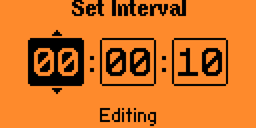</td>
  </tr>
  <tr style="border:0px">
    <td style="border:0px" width="25%" align="left">
    Interval timing modes: <br>
     <ul>
       <li>Relative: Interval is length of time from `END` of one transmission to `START` of next.</li>
       <li>Precise: Interval is length of time from `START` of one transmission to `START` of next.</li>
     </ul>
     Not used with the <code>Time</code> schedule.
    </td>
    <td style="border:0px" width="20%"></td>
  </tr>
 <tr style="border:0px">
  <td style="border:0px" width="25%" align="left">
    Data Tx Count:<br>
  <ul>
  <li>x1, x2, x3, x4, x5, x6</li>
  </ul>
  </td>
  <td style="border:0px" width="20%"></td>
<tr style="border:0px">
  <td style="border:0px" width="25%" align="left">
    Transmission Modes:<br>
  <ul>
  <li>Normal: Transmit after intervals.</li>
  <li>Immediate: Counts start as interval.</li>
  <li>One-Shot: Wait interval and transmits once. With a stepped playlist, sends one line (plus any following lines with a zero wait).</li>
  </ul>
  </td>
  <td style="border:0px" width="20%">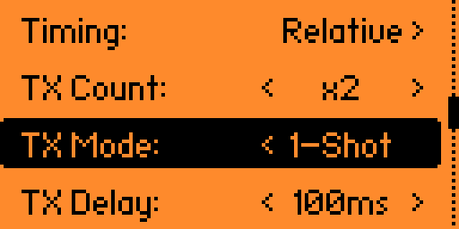</td>
 </tr>
<tr style="border:0px">
  <td style="border:0px" width="25%" align="left">
   Inter-transmission delay selectable<br>
   from 0ms to 1000ms in 50ms increments.
  </td>
   <td style="border:0px" width="20%">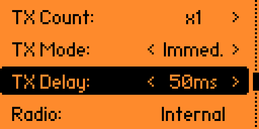</td>
  </tr>
  <tr style="border:0px">
  <td style="border:0px" width="25%" align="left">
   Radio Selection:<br>
   <ul>
    <li>Internal</li>
    <li>External (When Present)</li>
   </ul>
  </td>
   <td style="border:0px" width="20%"></td>
  </tr>
    <tr style="border:0px">
  <td style="border:0px" width="25%" align="left">
   Save settings for later use.<br>
  </td>
   <td style="border:0px" width="20%">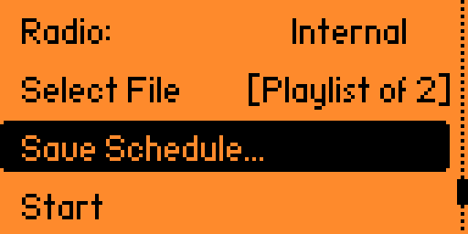</td>
  </tr>
  <tr style="border:0px">
  <td style="border:0px" width="25%" align="left">
   Run view displays:
    <ul>
      <li>TX Mode</li>
      <li>TX Interval</li>
      <li>TX Count</li>
      <li>Radio</li>
      <li>Selected File</li>
      <li>TX Interval Countdown (<code>Sending</code> while transmitting)</li>
      <li>Next playlist line, when stepping</li>
    </ul>
  </td>
   <td style="border:0px" width="20%"></td>
  </tr>
</table>

## Playlist Scheduling

### Build a playlist on the Flipper

Each signal is a separate entry, so select the same `.sub` file again whenever you want to repeat it. Add a wait before the signal it should delay. These screenshots show the steps on a Flipper Zero:

| Step | Screen |
|---|---|
| 1. Open **Build Playlist** from the app's main menu. | 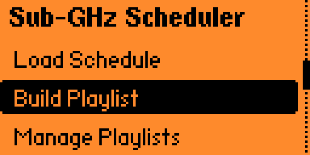 |
| 2. Choose **Add wait...** to start with a delay, or **Add signal...** to start immediately. | 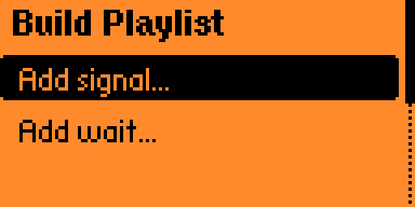 |
| 3. For a wait, enter the number of seconds before the next signal. Add more waits later wherever needed. | 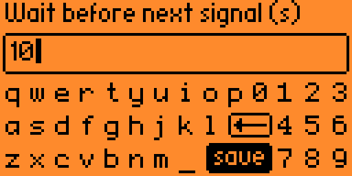 |
| 4. Choose **Add signal...** and select a `.sub` file. Repeat this for every transmission, including repeats of the same file. | 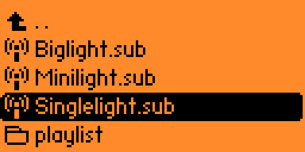 |
| 5. Review the numbered entries. **Remove last** undoes the most recent entry; **Clear list** starts over. | 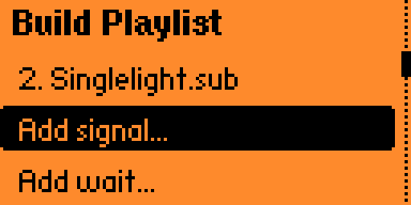 |
| 6. Choose **Save playlist...**, enter a name, and select **save** on the keyboard. The app writes a `.txt` file to `/ext/subghz/playlist/`. | 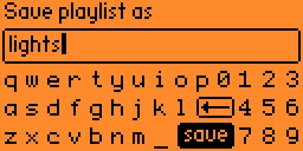 |

To run it, choose **New Schedule → Select File**, select the saved `.txt` file, then **Start**. A playlist with waits shows the next signal and countdown on the run screen:

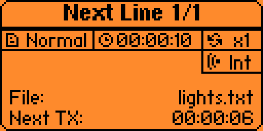

### Timed playlist text files

Create a playlist through **Build Playlist** or write a `.txt` file directly. Select `Add signal...` for every transmission, including repeats of the same signal. Select `Add wait...` to set the delay in seconds before the next signal. The builder saves these entries under `/ext/subghz/playlist/`.

For example:

```text
time: 10
sub: /ext/subghz/speed_up.sub
sub: /ext/subghz/speed_up.sub
sub: /ext/subghz/speed_up.sub
time: 100
sub: /ext/subghz/slow_down.sub
sub: /ext/subghz/slow_down.sub
time: 15
sub: /ext/subghz/speed_up.sub
```

Each `time:` applies to the next `sub:` line. Consecutive `sub:` lines without another `time:` are sent back to back, with the configured TX Delay between them. A missing initial `time:` means the first signal starts immediately. After the final line, **Normal** mode repeats from the first line and applies its wait again. **1-Shot** mode runs through all lines once and stops. `time:` must contain a whole number from 0 to 359999 seconds and be followed by a `sub:` line; `.txt` playlists support up to 127 signals. Use paths that exist on your Flipper; the examples above use the stock SD card prefix `/ext`.

To run a hand-written file, choose **New Schedule → Select File**, select the `.txt` file, then **Start**. The app reads waits from the file automatically. Plain `sub:` playlists still use the schedule options below.

### Manage saved playlists

Open **Manage Playlists** from the app's main menu to rename or delete `.txt` files saved in `/ext/subghz/playlist/`.

| Step | Screen |
|---|---|
| 1. Select **Manage Playlists**. | 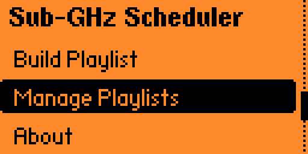 |
| 2. Choose a saved playlist. | 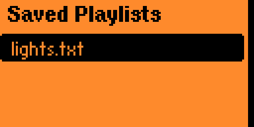 |
| 3. Choose **Rename** or **Delete**. | 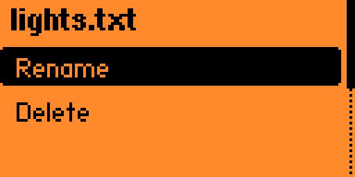 |

**Delete** asks for confirmation before removing the playlist file:

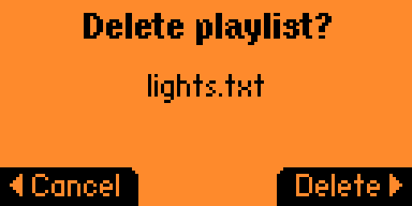

Renaming or deleting a playlist changes its `.txt` file, not the referenced `.sub` signals.

### Schedule options

When a playlist (`*.txt`) is selected, extra options appear in the schedule menu.

**Step**
* `All`: every trigger sends the whole playlist (default, same as before).
* `One`: every trigger sends the next line of the playlist. After the last line it starts over at line 1.

**Schedule** (only with Step `One`)
* `Uniform`: one interval for every line, set with `Interval`.
* `Per Line`: every line has its own wait before it is sent. A wait of `00:00:00` sends the line right after the previous one, so lines can be grouped.
* `Time`: every line is sent at a time of day (`HH:MM:SS`), in playlist order, repeating daily. Lines with the same time are sent one after the other.

**Start** (only with Schedule `Time`)
* `Line 1`: start with line 1 and wait for its time, even if that is tomorrow (default).
* `Nearest`: start with the line whose time comes up first, then continue in playlist order. Started at 19:00 in the example below, line 4 is sent at 23:00 and line 1 the next day at 17:30:00.

Set the wait or time of each line under `Edit Lines...`. The same time editor is used: Left/Right select a block, Up/Down change it, OK saves and Back cancels. Settings entered through `Edit Lines...` are stored in the `*.sch` file. Timed playlists built with `Add wait...` store their waits as `time:` lines in the `.txt` file. The stock `SubGHz Playlist` app can still read the `sub:` entries, but it does not apply these waits.

Example: a playlist with 4 lines and Schedule `Time`:

| Line | Time | Sent |
|---|---|---|
| 1 | 17:30:00 | 17:30:00 |
| 2 | 18:00:00 | 18:00:00 |
| 3 | 18:00:00 | right after line 2 |
| 4 | 23:00:00 | 23:00:00, then line 1 again the next day at 17:30:00 |

Notes:
* To send the same signal more than once a day, list its `*.sub` file more than once in the playlist. Every entry is a separate line with its own wait or time.
* Times use the Flipper clock, so make sure date and time are set correctly.
* Playlists can have up to 127 lines.
* The red LED only blinks during the last minute before a send, so long waits stay dark.
* The app has to stay open on the run screen. Charging is only blocked while transmitting, so the Flipper can stay on USB power for long schedules.


## Requirements

This app is tested against the current `dev` and `release` branches of the [OFW](https://github.com/flipperdevices/flipperzero-firmware):

* Current OFW Version: 1.5.1
<br>[](https://github.com/shalebridge/flipper-subghz-scheduler/actions/workflows/build.yml)

It has also been tested against [Momentum 009](https://github.com/Next-Flip/Momentum-Firmware/releases/tag/mntm-009). Playlist scheduling (v3.2) was tested on Momentum (API 87.1).

> [!NOTE]
> Currently not supported on Xtreme, as development of that firmware was officially [discontinued on Nov 18, 2024](https://github.com/Flipper-XFW/Xtreme-Firmware/commit/54619d013a120897eeade491decf4d1e95217c06). Since then, breaking changes were made to the Furi API. For those who still use Xtreme I am working on a separate port.

## Build

These apps are built using [ufbt](https://pypi.org/project/ufbt/) - a subset of the flipper build tool (fbt) targeted at building apps. Install it with:

```bash
pip install ufbt
```

For build only, run `ufbt` from the terminal in the project directory. To upload, make sure Flipper is connected to your computer and run `ufbt launch`.

The directory contains the following batch script(s) to simplify the upload process:
* `launch_win.bat` - Windows only. Invokes `ufbt` to deploy and launch the app on a flipper over USB, and resets terminal colors in case of error.

Build outputs are found in the `dist` directory for each application.


# To-Do
- [ ] Enable running in the background.
- [x] Enable interval delays for playlists. For example, turning on a light (playlist index 1), then 4 hours later turning it off (playlist index 2). See Step `One` with Schedule `Per Line`.
- [ ] More visual feedback of current transmission (like `SubGHz Playlist`).
- [ ] Options to select notifications on transmit (vibro, backlight, etc).
